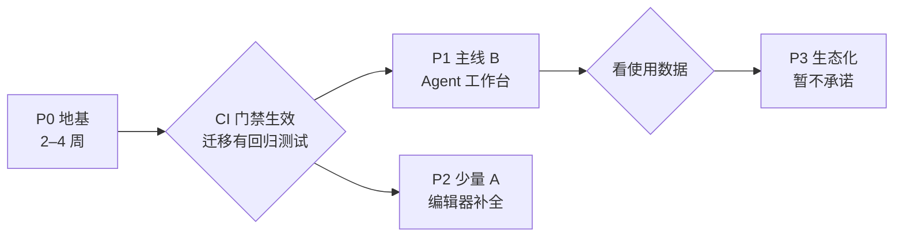

# Snow App 演进规划

> 本文件是 `lsg1103275794/snow-app`（fork 自 `MayDay-wpf/snow-app`）的演进规划。
> 方向已定：**先打地基（P0），再以「Agent 工作台」为主线（P1），「AI IDE 化」只做少量投入（P2）。**
> 基线：2026-11-21，提交 `7aa2bedd`（v0.5.23）。所有工期都是粗估，未按团队人数校准。

## 1. 基线事实

以下数字均在基线提交上实测。

| 项 | 现状 |
| --- | --- |
| 自动化测试 | Rust 侧 1 个 `#[test]`，TS 侧 0 个测试文件 |
| CI | 只有 `.github/workflows/release.yml`，由 `v*` 标签或手动触发；没有 PR 门禁 |
| 数据库迁移 | schema v71（`native/crates/snow-storage-core/src/database.rs:60`），55 个 `migrate_*` 函数，无回归测试 |
| 原生层结构 | 已拆为 20 个 crate（`native/crates/*`），`native/src` 只保留 NAPI 导出 |
| 最大文件 | `src/renderer/styles.css` 65909 行；`native/crates/snow-mcp/src/servers/config/mod.rs` 4435 行；`GeneralSettingsPanel.tsx` 3769 行 |
| 编辑器内核 | 文件查看器已是 CodeMirror 6（`src/renderer/components/rightPanel/fileViewer/CodeEditor.tsx`），有代码折叠；未见补全、多光标、悬停、诊断扩展 |
| 记忆检索 | 纯关键词打分，无向量检索（`native/crates/snow-storage/src/project_memories.rs:1252`） |
| 插件安全 | 市场安装有 SHA-256 校验（`native/crates/snow-plugin/src/market.rs`）；没有签名校验 |
| 上游节奏 | 近 30 天 328 次提交、改动 1902 个文件；近 10 周每周 45–128 次提交 |

上游近 30 天改动最频繁的文件：

| 文件 | 改动次数 |
| --- | --- |
| `src/renderer/styles.css` | 140 |
| `src/renderer/i18n/lang/{en,zh-CN,zh-TW}.ts` | 各 137 |
| `src/main/native/types.ts` | 74 |
| `native/Cargo.toml`、`native/Cargo.lock` | 各 30 |
| `package.json` | 29 |

## 2. Fork 策略

上游每周几十到上百次提交，这决定了我们怎么改代码。

- **跟随上游，不硬分叉。** `origin` 是我们的仓库，`upstream` 是原仓库；每周把 `upstream/main` 合并进 `main`（用 merge，不 rebase 已推送的历史）。
- **新增优先于修改。** 新功能写进新文件、新 crate、新工作流；上表的热点文件只做单行级的必要改动。
- **不拆巨型文件。** 拆 `styles.css` 这类文件会让每周合并都冲突。此前评估里"拆巨型文件"一项因此取消，改为"新代码不再写进这些文件"。
- **通用修复回提上游。** 上游的贡献规则（`CONTRIBUTING.md`）要求：不改核心 AI Loop、第三方代码注明来源、UI 通过多主题切换检查。
- **许可证。** 上游是 MIT，保留原版权声明。

转为硬分叉的条件：连续 4 周合并冲突处理超过当周开发量的 20%，或上游方向与主线 B 冲突。

## 3. 阶段总览

投入比例（建议值，待确认）：P0 期间 100% 投地基；之后 B 约 80%，A 不超过 20%。

## 4. P0 地基（粗估 2–4 周）

目标：让后续每一次改动和每一次上游合并都有自动检查兜底。全部是新增文件，不碰热点文件。

| 编号 | 事项 | 做法 | 完成标准 |
| --- | --- | --- | --- |
| P0-1 | 仓库与发布通道 | `origin/main` 追平上游；决定是否同步标签；在 fork 上启用 Actions 并跑通一次发布 | fork 上有至少一个带 `latest.yml`、`latest-mac.json`、`latest-zh.json` 的 Release |
| P0-2 | PR 门禁 | 新增 `.github/workflows/ci.yml`：复用现有的 `npm run check`（`tsc --noEmit` + `cargo check`）和 `npm run check:docs`，再加 `cargo test --workspace` | `main` 设为受保护分支，CI 不过不能合并 |
| P0-3 | 迁移回归测试 | 在 `snow-storage-core` 加测试：空库升到 v71；若干历史版本的样本库升到 v71 后表结构一致 | 新增迁移必须带对应测试，CI 强制 |
| P0-4 | 待改模块的特征测试 | 给 P1 要动的代码先补测试：记忆打分与去重、插件清单规范化、市场包 SHA-256 校验 | 这三个模块的现有行为被测试锁定 |
| P0-5 | TS 测试框架 | 选定框架，先覆盖 `src/main` 里的纯逻辑（更新器清单解析、IPC 参数校验） | CI 里有 TS 测试一步，至少 1 个模块有测试 |
| P0-6 | 上游同步流程 | 写一份每周合并的步骤；合并 PR 同样过 CI | 连续 2 周按流程合并成功 |

P0-1 需要先做：自动更新源已指向我们的仓库，而它目前没有任何 Release，所以从 fork 构建的安装包在首个 Release 发布前检查更新会失败。

## 5. P1 主线 B：Agent 工作台

护城河是 Agent 编排、工具体系和应用深度联动，P1 的投入都加在这三处。

| 编号 | 事项 | 内容 | 粗估 | 约束 |
| --- | --- | --- | --- | --- |
| B1-a | 记忆衰减与近似去重 | 按记忆类型设半衰期的指数衰减；标题近似匹配去重 | 2–3 天 | 不改注入快照的冻结语义 |
| B1-b | 记忆混合检索 | `project_memories` 加 embedding 列，关键词 + 向量混合排序；复用代码库索引已有的 embedding 配置，未配置时回退关键词 | 约 1 周 | 零依赖开箱即用；迁移带回归测试 |
| B1-c | 记忆关系与导出 | 关系表；Markdown 导出 | 约 1 周 | 跟随 `response_id` 回滚、工作区迁移、孤儿清理 |
| B2 | 插件信任链 | 包签名校验；宿主版本兼容声明；安装时展示权限；ESM 面板隔离方案 | 待拆分 | 不破坏已安装插件 |
| B3 | 授权与副作用队列 | 把"谁能发起工作"与"上下文内容"分开记录（Mandate）；后台任务用"事务内入队、提交后执行、退避重试"的持久队列 | 待拆分 | 先用于子代理、定时任务、远程控制 |
| B4 | 工具与模板 | 语义化 toolSearch；工作流/子代理模板 | 待拆分 | — |
| B5 | 主动式 Agent（待决策） | 事件源 + 准入 + 工单，先只接 GitHub，默认只记录不执行 | 2–3 周 | 依赖 B3；是否立项见第 8 节 |

顺序：B1-a → B3 → B2 → B1-b → B1-c → B4。B1-a 最小，用来验证 P0 的测试和 CI 流程；B3 排在 B2 前，因为 B5 和插件权限都要用它。

B2 里"ESM 面板不隔离"、B3/B5 的设计来源（`dsh-superagent-prototype` 的 `docs/002-authorization.md`、`src/app/effects.ts`）沿用此前评估，开工前按当前代码复核。只借鉴设计，不引入其代码依赖。

## 6. P2 少量 A：编辑器补全

上游已把文件查看器换成 CodeMirror 6，"编辑器内核选型"不再需要决策。P2 只做在它之上的低成本补全。

| 编号 | 事项 | 说明 |
| --- | --- | --- |
| A1 | 基础编辑能力 | 打开 CodeMirror 已有扩展：多光标、搜索替换快捷键、括号匹配 |
| A2 | LSP 接入编辑器 | 悬停、诊断、跳转定义。渲染层已有 LSP 状态徽标和工具结果视图（`LspStatusBadge.tsx`、`LspToolCall.tsx`），但文件查看器里未见悬停或诊断扩展 |
| A3 | 逐块接受/拒绝 | 在现有 Diff 视图上做 AI 改动的逐块确认 |

明确不做：调试器、Tab 补全模型、行内改写（Ctrl+K）。

## 7. P3 生态化

暂不承诺。启动条件：B2 完成，且第三方插件数量或安装量出现增长。届时再评估插件市场是否迁到我们自己的仓库。

## 8. 待决策

| 编号 | 问题 | 影响 |
| --- | --- | --- |
| D1 | 主动式 Agent（B5）是否进入未来两个季度 | 不进则 B3 范围缩小 |
| D2 | 是否同步上游 119 个标签到 fork | 同步后需确认不会触发 fork 上的发布流程 |
| D3 | 是否向上游回提通用修复 | 决定 P0-2、P0-3 是否按上游贡献规则准备 |
| D4 | 团队人数与每周可投入量 | 所有工期需据此校准 |
| D5 | A 的投入上限 20% 是否合适 | 决定 P2 的排期 |

## 9. 仓库指向现状

| 位置 | 指向 | 状态 |
| --- | --- | --- |
| 自动更新源（`package.json` 的 `build.publish`、`dev-app-update.yml`、`scripts/generate-latest-json.cjs`、`src/main/updater/macUpdater.ts`、`src/main/updater/releaseNotesZh.ts`） | 我们的仓库 | 已改 |
| 设置页"关于"里的仓库链接（`GeneralSettingsPanel.tsx`） | 我们的仓库 | 已改 |
| 插件市场（`native/crates/snow-plugin/src/market.rs`、`src/renderer/plugins/market.ts`） | 上游 | 有意保留 |
| README 徽章、`docs/` 里的链接、隐私设置页链接、内置文档技能 | 上游 | 未改，随 P0-1 一并处理 |
