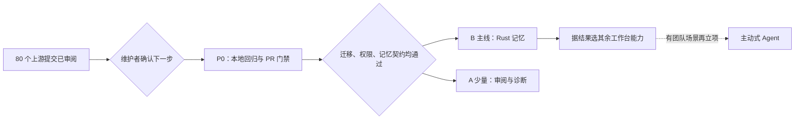

# Snow App 演进规划

> 这是 `lsg1103275794/snow-app` 的 fork 规划。方向已定：**先打地基（P0），以 Agent 工作台（B）为主线，IDE 能力（A）只做少量投入。** 不按人数或工期排程，按依赖和验收结果推进。
>
> 决策基线：2026-11-21，`7aa2bedd`（v0.5.23）。依据是[八个版本、80 个提交的上游审阅](reviews/upstream-v0.5.15-v0.5.23.md)。下文的“基线事实”描述上游，不计入 fork 新增的测试。P0 第一批已获准本地实施；[路线索引](../ROADMAP.md)与[验收记录](verification/2026-11-21-p0-regression.md)给出当前状态。B/A 和远端发布不在本轮授权内。

## 1. 已经有的能力，与真正的缺口

| 领域         | 基线事实                                                                                                                                                                                                                           | fork 的取舍                                                                                   |
| ------------ | ---------------------------------------------------------------------------------------------------------------------------------------------------------------------------------------------------------------------------------- | --------------------------------------------------------------------------------------------- |
| 质量与迁移   | 只有[标签发布工作流](../.github/workflows/release.yml)，没有 PR 门禁。按文件名未见 JS/TS 测试；识别到的 Rust `#[test]` 受 Unix 条件限制。SQLite 从 v69 经 v70 到 [v71](../native/crates/snow-storage-core/src/database.rs)。       | 先做能暴露升级回归的测试，不以全仓覆盖率或大规模重构作为起点。                                |
| 原生层       | `native/crates/*` 已有 20 个 crate；[根入口](../native/src/lib.rs)重导出 `snow_exports`，业务不再集中在旧 `native/src/storage`。                                                                                                   | 在现有 crate 的接口处扩展；第三方项目不是新的运行时基座。                                     |
| Agent 工作台 | 上游已有增量/异步会话压缩、`context-recall`、后台回复预测、Team 投票及子代理失败交接；工具已按动作合并。                                                                                                                           | 保留这些实现。优先补权限和数据回归，再增强跨会话记忆，不再做另一套压缩器。                    |
| 项目记忆     | 已有 `memory-manage`、UI 的项目/全局迁域、同名合并和会话冻结快照。[现有检索](../native/crates/snow-storage/src/project_memories.rs)按标题、正文、标签文本命中排序，不是向量检索。                                                  | **引入 oh-memos 的算法思路，用 Rust 在现有记忆模块实现**，见 B1；不迁移事实数据到第二个系统。 |
| 编辑器       | [编辑态](../src/renderer/components/rightPanel/fileViewer/CodeEditor.tsx)和[只读态](../src/renderer/components/rightPanel/fileViewer/CodeViewer.tsx)已用 CodeMirror 6。渲染层已有 LSP 状态与工具结果视图，不等于编辑器内已有诊断。 | 不再选编辑器内核、不上 Monaco；只有直接改善 Agent 产物审阅的需求才进入 A。                    |
| 插件、备份   | [插件市场](../native/crates/snow-plugin/src/market.rs)安装有 SHA-256 校验，不等于发布者签名；[备份任务日志](../native/crates/snow-storage-services/src/services/backup/journal.rs)可中断恢复，不等于通用消息队列。                 | 保留上游市场；先测试既有完整性校验和恢复语义，再决定扩展信任或队列的范围。                    |

## 2. Fork 与发布边界

- `origin` 是我们的公开 fork，`upstream` 是原仓库；本地 `main` 跟踪 `origin/main`。审阅时 fork 在 `69149068`，本地有 80 个上游提交 + 2 个自有提交（`397af379`：更新源及关于页；`5f8cde66`：首次规划）。**本地已经包含上游终点，不需要再做合并。**
- **已经决定同步 fork 和上游历史标签，当前暂停所有推送。** 本地快照有 119 个标签；执行前重新对比两端对象，不把本地独有标签误作上游标签，不覆盖同名异物，不镜像或强推。先核查 fork 的 Actions 设置与 `v*` 推送触发，再分别确认分支推送、历史标签同步。同步标签不会复制上游的 GitHub Releases 或安装包。
- **自己的发布是第三件事。** 自动更新的 5 处来源及关于页在本地提交中已指向 fork。上次核对 fork 无 Release，首个正式 Release 前不能把更新通道标为可用。发布需另行确认，核验 `latest*.yml`、`latest-mac.json`、`latest-zh.json` 与真实产物相符。不承诺上游已停发的 Intel Mac 包。
- 插件市场继续指向上游；README 徽章、现有用户文档及隐私设置页链接未改。后续只根据实际归属调整，不全局替换仓库所有者。保留 MIT 版权声明。
- 建议按周查看上游；每次同步单独审阅和确认，用 merge，不 rebase 已公开历史。近 30 天基线中 `styles.css` 被改 140 次、三个语言文件各 137 次，新功能尽量用新文件。保留原有复评线：若连续 4 周处理上游冲突超过当期开发投入的 20%，或上游方向与 B 冲突，再讨论硬分叉。这是维护指标，不是交付工期。
- 向原仓库提交 Issue / PR 时遵守 [CONTRIBUTING.md](../CONTRIBUTING.md)：由人撰写提交说明、注明第三方代码来源、不直接改核心 AI Loop，涉及 UI 时检查多主题。

## 3. 先后关系：按验收推进，不定工期

远端发布和标签同步需要单独许可，**不阻塞本地测试设计**。若需要数字来约束范围，B/A 可沿用 80/20 作为讨论上限，不是排期或已批准配额；有冲突时 A 让位于 P0 和 B。

## 4. P0：把上游升级变成可验证的基线（第一批已启动）

| 编号                    | 交付物                                                                                                                                                                        | 通过条件                                                                                                                |
| ----------------------- | ----------------------------------------------------------------------------------------------------------------------------------------------------------------------------- | ----------------------------------------------------------------------------------------------------------------------- |
| P0-1 仓库与发布         | 一份“本地→分支→历史标签→自有 Release”的放行清单。                                                                                                                             | 只读确认对象、标签冲突、发布触发和自有更新 URL；远端步骤分别由维护者确认。没有 fork 产物，不宣称自动更新可用。          |
| P0-2 PR 检查            | 拟新增独立 CI，复用 `npm run check`、`npm run check:docs`；从仓库根运行 `cargo test --manifest-path native/Cargo.toml --workspace`，覆盖 Unix 测试，另验证 Windows 专用依赖。 | 相同输入本地和 CI 给同一结果；一次故意失败的测试能阻挡合并。启用 Actions 和分支保护是另行确认的仓库设置，不在本轮执行。 |
| P0-3 数据迁移           | 用合成的空库、v69 和 v70 样本升级到基线 v71。v70 的新增项是敏感命令反馈表；v71 是 MCP OAuth 位。                                                                              | 表结构、数据和作用域都保持；旧 MCP 配置默认关闭 OAuth；同一库再次启动不重复损坏数据。不使用个人数据库或真实凭据。       |
| P0-4 权限与记忆特征测试 | 用旧配置、旧终端授权及子代理工具名单验证升级；锁定记忆打分、合并、可见域和冻结快照，并保留市场包 SHA-256 的正反例。                                                           | 旧许可不扩大成整组放行；冻结快照前后逐字相同；项目互不串读；回滚、可选连删、迁域、工作区重关联和孤儿清理均有复现样例。  |
| P0-5 TS 测试入口        | 先选一个不依赖 Electron 窗口的纯逻辑模块，如更新清单解析或 IPC 参数校验。                                                                                                     | 有可重复的成功与失败用例，并在 CI 中真正执行；不把语法检查误算为测试。                                                  |
| P0-6 跟进上游           | 对同步后的分支重复上述检查；重点核对热点文件、N-API 接口、发布矩阵和 fork 独有的六处地址。                                                                                    | 结果可重放、失败可定位；业务变更与上游同步分开审阅。                                                                    |

## 5. P1 / B：Agent 工作台

### B1：Rust 记忆块，明确借鉴 oh-memos

**引入的是算法，不是服务。** 不整包引入 oh-memos，不用它的 JSONL 替换 SQLite，不要求安装 Python、Qdrant、Neo4j 或 Ollama。想独立使用 oh-memos 的用户仍可选配外部 MCP，但它不是 Snow 的启动依赖，也不参与双写。这延续此前“不深度集成”的决定。

**落点和不变项。** 排序、去重及存储契约落在 [snow-storage / project_memories.rs](../native/crates/snow-storage/src/project_memories.rs)；更改数据结构走 [snow-storage 迁移](../native/crates/snow-storage/src/migrations.rs)和 [schema 版本](../native/crates/snow-storage-core/src/database.rs)。[snow-tools 的记忆注入](../native/crates/snow-tools/src/servers/memory.rs)在读到会话快照后直接返回，检索增强不得改写这个前缀。`context-recall` 和项目记忆仍分属两个工具域。

| 增量                            | 实现边界                                                                                                                                                                                                                                                                                      | 验收 / 回退                                                                                                                                                        |
| ------------------------------- | --------------------------------------------------------------------------------------------------------------------------------------------------------------------------------------------------------------------------------------------------------------------------------------------- | ------------------------------------------------------------------------------------------------------------------------------------------------------------------ |
| B1-a 时间衰减与近似去重（首选） | 在关键词基线上按记忆类型设半衰期。保留当前同作用域精确同名合并；近似命中先做候选，不凭相似标题自动覆盖互相矛盾的事实。先不改 schema、不发网络请求。                                                                                                                                           | 用固定时钟和标注样例对比新旧排序；必须覆盖长期偏好、过期任务、近义反义标题、不同项目同名、归档项。报告前五条命中和误合并数；不比基线好则保留旧策略。               |
| B1-b 可选的关键词 + 向量检索    | 复用已有 embedding 配置能力，但对**记忆文本**另行选择启用和告知去向；默认纯本地关键词。以 `memory_id` 关联向量、模型/维度和有效性，先过滤可见域，再合并候选。计算放上层或通过窄接口注入；[snow-retrieval 已依赖 snow-storage](../native/crates/snow-retrieval/Cargo.toml)，不得引入反向依赖。 | 无配置、离线、模型切换、维度不符均能回退；评测包含没有共同关键词的查询。模型/文本改变可重建索引，失败不阻断保存；未授权的项目记忆不出现在候选中。                  |
| B1-c 关系与 Markdown 导出       | 用 SQLite 表关联已有记忆，不上图数据库；按所选作用域导出 Markdown，不默认连带全局记忆或来源会话全文。依赖数据生命周期测试，不以是否部署向量服务为前提。                                                                                                                                       | 按 `response_id` 回滚后，派生索引/关系不会残留；删除会话默认保留记忆，只有选择连删时才清除。项目→全局→项目、工作区重关联、孤儿清理后，导出不串项目、不产生悬空边。 |

**开工条件：** P0 的迁移及记忆契约已通过，维护者再批准 B1-a。B1-b 须先拿到关键词基线测不好的真实类别和独立的隐私方案；没有证据就停在 B1-a。B1 三项现在都是规划，不是上游功能或本轮已实现功能。

### B 的其余候选

| 编号              | 做什么                                                                                                                    | 何时值得做                                                                                              |
| ----------------- | ------------------------------------------------------------------------------------------------------------------------- | ------------------------------------------------------------------------------------------------------- |
| B2 插件信任       | 在已有市场 SHA-256 之上评估发布者签名、宿主版本声明和 ESM 面板隔离。                                                      | 先复核现有权限、沙箱及旧插件迁移路径，不因新增保护而默认信任旧插件。                                    |
| B3 任务授权与回写 | 参考 `dsh-superagent-prototype` 的 Mandate（谁授权了什么）和事务内入队、提交后回写的设计；不引入 DSH 宿主或另一套数据库。 | 先在现有子代理/定时任务定位一个重启丢失、重复回写或授权不清的具体场景；已有备份任务日志不等于通用队列。 |
| B4 工具与模板     | 在现有工具搜索上评估语义排序与工作流/子代理模板。                                                                         | 用真实失败查询衡量收益，不再拆回上游刚合并的工具。                                                      |
| B5 主动式 Agent   | 事件源→准入→工单；若立项，先只接 GitHub，默认只记录“本会接受”，不执行。                                                   | **尚未立项**。先证明团队有持续需求，且 B3 的幂等、撤销和人工审批可验证。                                |

## 6. P2 / A：只改善 Agent 产物的审阅

| 候选        | 最小范围                                                            | 不做                                      |
| ----------- | ------------------------------------------------------------------- | ----------------------------------------- |
| A1 基础编辑 | 复用 CodeMirror 6，先实测两态的搜索、折叠与快捷键，只补明确缺口。   | 不替换内核、不同步维护两套编辑器。        |
| A2 诊断     | 将现有 LSP 结果用于正在审阅的文件，先只读展示、跳转，再按需做悬停。 | 不重写 LSP、不做调试器或生成式 Tab 补全。 |
| A3 差异确认 | 在已有 Diff 上验证逐块接受/拒绝，并保持拒绝后的文件与状态一致。     | 不做通用行内改写产品。                    |

P3 生态化暂不承诺：等 B2 具备安全安装/兼容性验证，并出现第三方插件使用证据，再讨论是否经营自己的市场。

## 7. 子代理怎么分工

| 角色                | 可独立交付                                           | 交接边界                                                       |
| ------------------- | ---------------------------------------------------- | -------------------------------------------------------------- |
| 上游审阅 Agent      | 标签对象、逐提交清单、兼容差异                       | 只读；不执行同步。本轮三段审阅的总账链接在页首。               |
| CI / 发布 Agent     | P0-1/2/5 检查配置和发布验收清单                      | 不持生产凭据，不自行启用 Actions、推送标签或发布。             |
| Rust 存储 Agent     | P0-3/4 的样本库及记忆契约；以后承担 B1               | 独占该次 schema 迁移写入；其他 Agent 只提交测试输入和期望。    |
| 权限 / 客户端 Agent | 新旧工具授权矩阵、作用域 UI 契约；A 获批后才接编辑器 | 不改存储 schema，不放宽审批。                                  |
| 独立验证 Agent      | 用同一基线重跑各模块检查，报告命令、输出和未验项     | 不自行修到“通过”；失败交回实现者。主维护者决定是否进入下一关。 |

**下一关仍是 P0。** 第一批的本地命令在[运行手册](runbooks/p0-regression.md)，通过项和缺口在[验收记录](verification/2026-11-21-p0-regression.md)。先补剩余高风险契约，再考虑跨平台 PR 门禁；不以本机绿灯代替 CI。B1/B5、远端分支/标签推送、自有首发及是否向上游贡献，均不在本轮实施范围。
